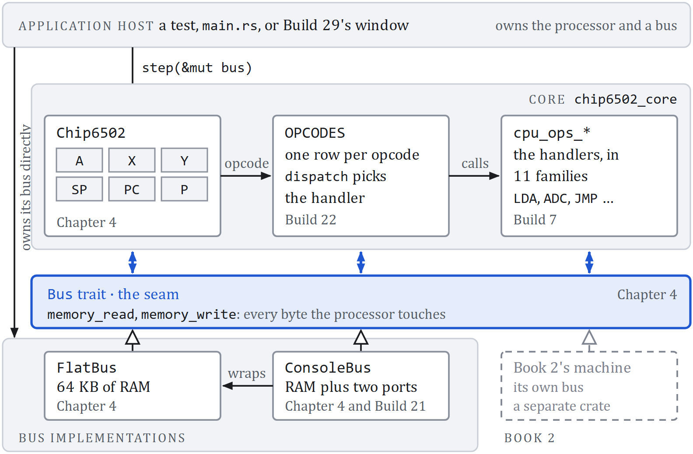

# 6502 Construction Set — Reference Implementation

This repository is the finished emulator from *6502 Construction Set*: an
NMOS 6502 processor core in safe Rust, the desktop application the book
builds around it, and the harness that runs a 1976 chess program on it. It is
the code the book's thirty builds arrive at, shared so you can read it
beside the book and compare with your own implementations.

The core implements all 151 documented opcodes, decimal mode with the NMOS
flag behavior, IRQ, NMI and `BRK`, and per-instruction cycle counts. It
passes Klaus Dormann's functional, decimal and interrupt conformance suites.

## What is The 6502 Construction Set?

The 6502 Construction Set is a book that teaches the reader how to build a 6502 emulator
in Rust. It uses eighteen core 6502 assembly language patterns across thirty builds as the basis for prioritizing
the implementation of opcodes, and teaches Rust and core systems programming concepts
along the way.

The book includes nostalgia and trivia from the era and finishes by showing
the user how to run Peter Jennings's Microchess on your own 6502 emulator.

But the emulator is really the vehicle. The goal is to learn how systems software is designed,
tested, and trusted. Now that AI can generate code in seconds, understanding how
to evaluate that code becomes more important, not less.

- Free chapters and the first build - "Hello World!": [silicon-arcade.com](https://silicon-arcade.com/?utm_source=github&utm_medium=readme&utm_campaign=reference_implementation)
- Buy the paperback: https://www.amazon.com/dp/B0HS4N9PR4
- Buy the eBook (DRM-free PDF and EPUB): https://leanpub.com/6502constructionset
- Code: https://github.com/Silicon-Arcade

The Silicon Arcade website also has **episodes**: animated walkthroughs of some of
the book's assembly listings, executing one instruction at a time with the
registers, flags and memory changing as they run —
[silicon-arcade.com/episodes](https://www.silicon-arcade.com/episodes/?utm_source=github&utm_medium=readme&utm_campaign=reference_implementation). I can build
more of these, so if there is a listing you would like to see run, [raise an
issue](../../issues) on this repository and tell me which one.

## What this is, and why I am sharing it

*6502 Construction Set* shares a destination — a working 6502 emulator in
Rust — and leaves the route and the final design to you. This repository is
one such destination: the full source of the emulator the book has you build, if
you follow its guidance fully. My goal with the construction sets though is that you
make your own decisions along the way, so your version may end up
different from this one. Treat it as a fork point, not a model to copy.

For folks who want to look before they set out, or who only ever wanted the
finished artifact, it is all here to read and to run. For folks using it alongside
the book, it is here to show the whole Rust solution in one piece, and to
show how the refactorings turn out — particularly the Build 7 interlude,
which moves a growing opcode `match` into a filing system of methods, and
the Build 22 interlude, which puts a dispatch table in front of it. Those
two change the design of the code more than anything else in the book, and
both are easier to follow once you have seen the finished form.

A word on the tests, because they serve two readers differently. `tests_unit.rs`
exercises one 6502 instruction at a time, and `tests_functional.rs` runs each build's
whole program against its expected output. Between them they are the fastest
way into this code — if you are here to understand the emulator rather than to
build one, start there rather than with `cpu.rs`. If you are working through the
book, the same two files are yours to write, and the book gives you everything
you need: every build prints its program and its expected output, and Build 1
establishes the template.

This is a clean-room build rather than my own emulator — [Where this code
came from](#where-this-code-came-from) says why.

## License

The code is licensed under the [Apache License 2.0](LICENSE), so you are free
to read it, run it, change it, and build on it, in your own projects or
commercial ones. Separately, I ask that this repository not be used to train,
fine-tune, evaluate, or benchmark AI or machine-learning models without prior
written permission; see [AI_POLICY.md](AI_POLICY.md) for the details.

The book itself, including its text, figures, and listings as published, is
not covered by this license; all rights are reserved.

## The workspace

| Crate | What it is | Book |
|---|---|---|
| `chip6502_core` | The processor, its buses, the disassembler, and the tests | Chapter 4 to Build 28 |
| `chip6502_core_app` | An egui window running Build 21's monitor | Build 29 |
| `chip6502_harness` | A terminal harness for raw 6502 images, used for Microchess | Build 30 |

## Requirements

- Rust 1.85 or newer (the workspace uses edition 2024; it was tested with 1.95).
- For `chip6502_core_app`: a desktop with OpenGL. On a machine without a
  working OpenGL driver, Appendix F gives the one-line switch to eframe's
  `wgpu` renderer.

## Building and running

```sh
cargo test
```

runs the unit tests (one instruction at a time), the functional tests (each
build's program, compared byte for byte with its expected output), the
architecture and cycle-table checks, the application's and harness's own
tests, an integration test and a doctest: 150 tests, all passing, and six
ignored. The ignored six need files this repository cannot ship: the three
conformance suites and three Microchess tests, both described below.

```sh
cargo run -p chip6502_core
```

runs Chapter 4's scaffold program and prints a single `H`, produced by the
emulated processor storing a byte to its console port.

```sh
cargo run -p chip6502_core_app
```

opens a 900×600 window titled "6502 Processor". Click **Run / Pause** and
the monitor prints its banner; type `?`, `A`, `B` or `Q` and it answers in
the transcript. `Q` ends the program, and the status returns to "Paused".

## Architectural overview

Appendix G of the 6502 Construction Set provides a complete overview of the intended
solution architecture including physical view (system), logical view (components),
development view (crates), process view and a scenario walkthrough. The diagram below
is a high-level summary of the architecture.



The diagram is explained in Chapter 5, which is free to read: [The Method and the Map](https://silicon-arcade.com/read/chapter-5/?utm_source=github&utm_medium=readme&utm_campaign=reference_implementation).


## The conformance suites (Build 26)

Build 26 evaluates the emulator against external sources: three
conformance suites, each a single 6502 program that exercises the processor
and then either reaches a known success point or stops at the test that
failed.

- **Functional**: Klaus Dormann's test of every documented opcode and
  addressing mode, checking results and flags.
- **Decimal**: Bruce Clark's test of `ADC` and `SBC` in decimal mode, across
  every combination of operands and carry.
- **Interrupt**: Klaus Dormann's test of IRQ, NMI and `BRK`.

The suites are not part of this repository, so their tests in `tests_kd.rs`
are ignored by a plain `cargo test`. Each one checks its suite's success
signal and also pins its instruction and cycle totals: the functional test
executes 30,646,177 instructions in 96,241,367 cycles, the decimal test
14,464,187 instructions, and the interrupt test 1,050.

For more about the suites, and how to run them against this code, see
Build 26, or Klaus Dormann's
[6502_65C02_functional_tests](https://github.com/Klaus2m5/6502_65C02_functional_tests)
repository on GitHub.

## Microchess (Build 30)

Build 30 is a case study. It runs a program that was not written for the
book: Peter Jennings's Microchess, a chess engine in about a KB of 6502
code, first sold in 1976, here in Daryl Rictor's serial-terminal adaptation with updates to support MMIO and some bug fixes identified during creation of Build 30.
The chapter walks through the program's history and its design, then reads
the listing for the patterns the book has taught you, and for a few it has
not.

Microchess is not in this repository; Build 30 explains where to get it and
what you may do with it. The chapter works from the 6502.org copy:
<https://6502.org/source/games/uchess/uchess.htm>.

Peter Jennings's own site, <https://www.benlo.com/microchess/>, is the
program's home. It has the history, the original 1976 KIM-1 manual and
listing, and his own copy of the serial-terminal adaptation carrying Bill
Forster's 2005 corrections to two scanning errors, and it says that
derivations of Microchess are open source
under the MIT License. If you want to share what you make, start from that
copy and follow the terms on his site; expect its assembler syntax and
addresses to differ from the copy Build 30 walks through.

Make the eleven changes Build 30 lists (five to update the program to run on your
emulator, four for the assembler, and two to correct bugs in the published
copy). The five changes required to support your emulator include:
the image must load and start at `$1000`, write output to `$F001`, and poll
`$F000` for input. Any raw 6502 program doing those three things will run
here; Microchess is just the one this book uses. A program that never reads
`$F000` runs to the instruction ceiling instead, which is what the harness
reports.

Then assemble with 64tass (or a similar 6502 assembler), and play:

```sh
64tass --nostart -o microchess.bin uchess.asm
cargo run --release -p chip6502_harness -- microchess.bin
```

Type `C` and Enter to set up the board, `P` for the program to move, and
moves as four digits (from-square, to-square). Build 30's structural tests
run against your image when you give them its absolute path:

```sh
MICROCHESS_BIN=/absolute/path/to/microchess.bin cargo test -p chip6502_harness -- --ignored
```

`.gitignore` already excludes `uchess*.asm`, `*.bin` and a `microchess/`
folder.

## Where each module comes from

| Module (`chip6502_core/src`) | What it holds | Introduced in |
|---|---|---|
| `bus.rs` | the `Bus` trait, the seam between processor and memory | Chapter 4 |
| `bus_flat.rs` | `FlatBus`, 64 KB of plain RAM | Chapter 4 |
| `bus_console.rs` | `ConsoleBus`: output at `$F001`, input at `$F000` | Chapter 4 (input: Build 21) |
| `cpu.rs` | `Chip6502`: registers, `reset`, `step`, interrupt lines | Chapter 4 |
| `main.rs` | the scaffold program that prints `H` | Chapter 4 |
| `flags.rs` | `StatusFlag`, the eight status bits | Chapter 5 |
| `tests_unit.rs` | unit tests, one instruction at a time | Chapter 5 |
| `tests_functional.rs` | each build's program, run to its halt | Build 1 |
| `cpu_helpers.rs` | the stack helpers and the address resolvers | Build 2 (resolvers: Build 22) |
| `addressing.rs` | the thirteen addressing modes | Build 3 |
| `disassemble.rs` | the disassembler | Build 3 |
| `cpu_ops_*.rs` | the instruction handlers, one family per file | Build 7 |
| `opcodes.rs` | the `OPCODES` table and the `dispatch` match | Build 22 |
| `tests_kd.rs` | the three conformance harnesses | Build 26 |
| `tests/unimplemented_opcode.rs` | the normal-build failure path | Build 28 |

`chip6502_core_app/src/main.rs` is Build 29, and `chip6502_harness/src/main.rs`
is Build 30. The crate documentation (`cargo doc --open`) carries the same
map, the failure-model policy from Build 28, and a short example.

## Where this code came from

This repository is the reference implementation for *6502 Construction Set*
(Book 1). It is not the emulator I originally wrote the book from.
That one is private: it carries Book 2's work and years of my experiments.

This code comes from **clean-room builds**. They were produced from the finished
chapters and nothing else — no access to my emulator or to any other
emulator's source, no answers to questions, and no me in the loop. Only then
did I review, correct and edit it for publication.

That choice is deliberate. A companion repository should be what following the
book actually produces. Publishing my private emulator would hand you code
that is in places inconsistent with the printed text: a different reset,
slightly different APIs, and 39 undocumented opcodes Book 1 defers until
Book 2.

### What was verified

By October 2026 I had put the book through eight independent clean-room
builds, each starting from the chapters alone and each judged against the same
external arbiter: the three [conformance suites](#the-conformance-suites-build-26).

| Check | Result |
|---|---|
| Builds completed | 8 |
| Reached all 151 documented opcodes | 8 of 8 |
| Passed all three conformance suites | 8 of 8 |
| Passed on the first attempt, with no fixes | 5 of 8 |

Each suite is a single 6502 program that runs until it reaches a known
address, so what is counted is not how many tests ran but how many
instructions the processor executed getting there: **30,646,177** for the
functional suite, **14,464,187** for decimal, **1,050** for interrupts.
45,111,414 in all — identical to my private emulator, to the
instruction, and in the same order. Two implementations can both pass a suite
by different routes through it. These took the same route.

### Why the published build is not an arbitrary pick

I compared three of the builds (built by different models) side by side, re-running every
check independently rather than trusting any build's own report: the full test
suites, `cargo clippy -- -D warnings`, `cargo fmt --check`, and the
conformance suites in release.

Over time they had converged. The same module layout. The same opcode table with grouped
dispatch. The same cycle model — detect in the helper, charge in `step`. The
same decimal-mode adjustment. Every row of every opcode table matched, 151
rows with 23 of them page-sensitive, and between 22% and 47% of each build's
substantial lines appear verbatim in the book, because the book prints them.

Independent builds agreed because the specification was tight. I seeded this
repository from the one that matched the book most closely, merged in
specific pieces from the other two, and corrected the book's own defects first.
Where a printed listing needed a correction to compile, to pass its own tests
or to meet the lint and documentation gates, the code carries the correction;
everywhere else it follows the listings as printed.

## Questions and feedback
I have spent a good amount of time considering what the right design and
implementation is but am sure issues will be found, or people will have
alternative preferences for the implementation. If you catch an error, or have
alternative suggestions for implementation please feel free to create an Issue
to track the discussion. Errata for the book are welcome in the same place.

I read everything that arrives, though replies may be slow while Book 2 is in
progress.

On pull requests: this code has to keep matching the printed listings, so I am
not taking changes to the design — an Issue is the better place for that
conversation. Genuine defects are the exception, and I would far rather hear
about those than not. [CONTRIBUTING.md](CONTRIBUTING.md) sets all of this out
in full.


## Additional resources

There are many resources describing how the 6502 processor works. Three that I found
particularly helpful were:
- **MOS Technology.** *MCS6500 Microcomputer Family Programming Manual*,
  1976. The reference for instruction behavior, flags and cycle counts.
- **Norbert Landsteiner.** [6502 Instruction Set](https://www.masswerk.at/6502/6502_instruction_set.html),
  masswerk.at. Opcode matrix and instruction details.
- **Andrew Jacobs.** [6502 Reference](https://6502.org/users/obelisk/6502/reference.html),
  6502.org. Per-instruction flag effects and cycle counts.
- **Western Design Center.** *W65C02S datasheet.* Documents the NMOS
  `JMP ($xxFF)` page-wrap bug and the 65C02's differences from the NMOS part.
- **Bruce Clark.** "Decimal Mode," tutorial, [6502.org](https://6502.org/).
  NMOS decimal-mode arithmetic and flags, and the D flag after reset.

The complete list of references can be found in Appendix H of the book.

### Test suites and tools (download them yourself)

- **Klaus Dormann.** [6502/65C02 functional tests](https://github.com/Klaus2m5/6502_65C02_functional_tests).
  GPL-3.0, which is why they are not included here. See
  [The conformance suites](#the-conformance-suites-build-26).
- **Bruce Clark.** `6502_decimal_test`, distributed with Dormann's tests.
  Public domain.
- **Frank A. Kingswood.** *AS65* cross-assembler, version 1.42, bundled with
  Dormann's tests (and again not included here). Assembles the decimal and interrupt tests.

### Programs the emulator runs (download them yourself)

- **Peter Jennings.** [Microchess](https://www.benlo.com/microchess/), 1976.
  Copyright Peter Jennings. See [Microchess](#microchess-build-30) for where
  to get it and the terms on his site.
- **Daryl Rictor.** [Microchess adapted for a serial terminal](https://6502.org/source/games/uchess/uchess.htm),
  2002. The version Build 30 runs.
- **Zsolt Kajtar.** [64tass](https://sourceforge.net/projects/tass64)
  cross-assembler. Assembles Microchess.

### Community

- [6502.org](https://6502.org/), maintained by Mike Naberezny and Garth Wilson. Excellent online community
containing archives, projects, 6502 source code, tools and forums. The forums are active,
and the members are knowledgeable and passionate about the chip.


### Design

- **Michael Feathers.** *Working Effectively with Legacy Code.* Prentice
  Hall, 2004. The source of the "seam" idea behind the `Bus` trait.

### Learning Rust

- **Steve Klabnik and Carol Nichols.** [*The Rust Programming Language*](https://doc.rust-lang.org/book/)
  ("the Rust book"). Free online.
- [*Rust by Example*](https://doc.rust-lang.org/rust-by-example/). Free online.
- **Jim Blandy, Jason Orendorff and Leonora F. S. Tindall.** *Programming
  Rust*, 2nd edition. O'Reilly, 2021.
- **egui.** [egui.rs](https://www.egui.rs/) and the
  [API documentation](https://docs.rs/egui), for `chip6502_core_app`'s
  user interface.
